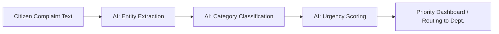

# 🏙️ AI-Powered Smart City Grievance Analysis System

> **1M1B AI for Sustainability Virtual Internship** — In collaboration with IBM SkillsBuild & AICTE

An AI-based prototype that automatically **categorizes, prioritizes, and summarizes** citizen grievances (potholes, garbage, water leakage, electricity issues, etc.) so municipal corporations can respond faster and manage cities more sustainably.

---

## 📌 Project Description

| Field | Details |
|---|---|
| **Title** | AI-Powered Smart City Grievance Analysis System |
| **Name / College** | *<Srishti Pandey>* / *<Shri Ramswaroop Memorial University>* |
| **Primary SDG** | SDG 11 – Sustainable Cities and Communities |
| **Secondary SDG** | SDG 16 – Peace, Justice and Strong Institutions |

### Problem Statement
> *"How might we use AI to automatically categorize and prioritize citizen grievances so that municipal corporations can respond faster and cities can become more sustainable and livable?"*

Municipal complaint systems today rely on manual reading and sorting of thousands of citizen grievances, causing delayed responses — especially for urgent issues like sewage overflow, gas leaks, or exposed live wires.

### Who Is Affected?
- **Citizens** — delayed resolution of everyday issues
- **Municipal staff** — manual workload sorting complaints
- **City administration** — poor visibility into ward-wise problem patterns

### Why AI Is Needed
- Manual triage of large complaint volumes is slow and inconsistent
- AI enables **automatic classification** (Water / Road / Garbage / Electricity / Other)
- AI enables **urgency/priority scoring** so critical issues surface first
- AI enables **pattern detection** across localities for better resource planning

---

## 🤖 AI Solution Overview

**Input:** Free-text citizen complaint (e.g., *"Water leaking near MG Road since 3 days"*)

**Pipeline:**
1. **Entity Extraction** — pulls out location & issue keywords
2. **Classification** — assigns a category (Water / Road / Garbage / Electricity / Other)
3. **Urgency Scoring** — flags High / Medium / Low priority based on issue type & keywords
4. **Summarization** — generates a short one-line summary for the dashboard



A working demo of this logic (prompt-based, no advanced coding required) is in [`prototype/classify_grievance.py`](prototype/classify_grievance.py).

---

## 🎯 Target Users
Municipal corporations, ward officers, and citizens using civic complaint portals (e.g., Swachhata App–style systems).

---

## ⚖️ Responsible AI Considerations
- **Fairness** — Complaints from all wards/localities and languages are treated equally; no locality is systematically deprioritized.
- **Transparency** — Every urgency score comes with a visible reason (e.g., "High: keyword 'sewage overflow' detected").
- **Privacy** — Personal identifiers (phone number, exact address) are masked before analysis/storage.
- **Ethics** — Spam/duplicate complaints are filtered without discarding genuine repeat complaints.

---

## 📈 Expected Impact
- Faster response time for high-severity issues
- Data-driven resource allocation for municipal bodies
- Better transparency for citizens on complaint status
- Scalable to any city/ward with minimal setup

---

## 📂 Repository Structure
```
grievance-ai-project/
├── README.md
├── prototype/
│   ├── classify_grievance.py     # Prompt-based classification & priority logic
│   └── sample_complaints.csv     # Sample input data
└── docs/
    └── sample_output.md          # Example input → output demo
```

---

## 🚀 How to Run the Prototype
```bash
cd prototype
python classify_grievance.py
```
This runs the sample complaints through the classification logic and prints categorized, prioritized output.

---

## 🧭 Design Thinking Process Followed
**Empathize → Define → Ideate → Prototype → Test & Refine**, as per the 1M1B AI for Sustainability project framework.

---

*Built as part of the 1M1B – IBM SkillsBuild AI for Sustainability Virtual Internship (July–Sep 2026).*
